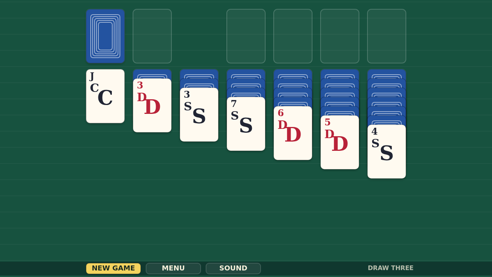
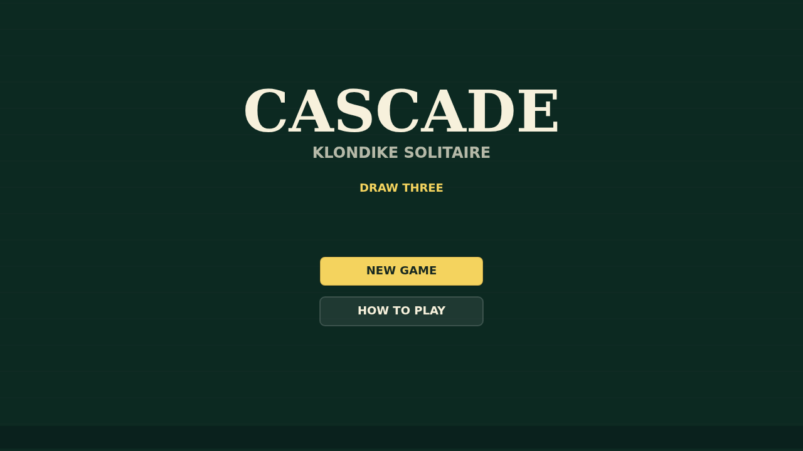
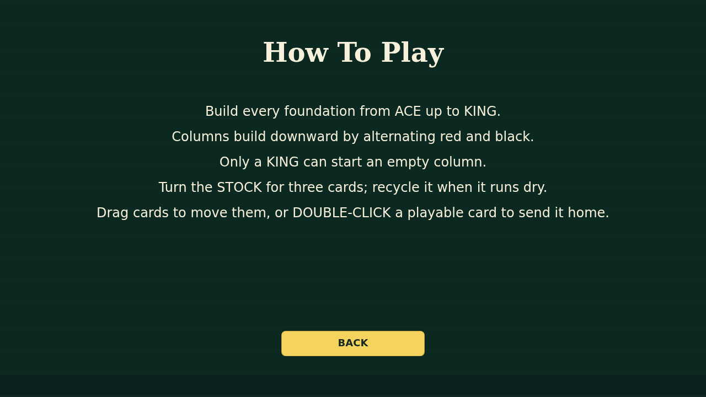

# Cascade

Cascade is a clean, tactile Klondike solitaire played in Draw Three mode. Turn
the stock, work the waste, and open the seven tableau columns by building
downward in alternating colors.

The goal is classic and readable: move every suit to the foundations from Ace to
King. Drag runs between columns, free buried cards, recycle the stock when it
runs dry, and double-click a ready card to send it home.

The finish is Cascade's flourish. Once the final King lands, the foundations
launch into a shower of cards that bounce and paint the felt until the table is
buried under the win.
